# MorphoWeave tutorial: from 110 molars to automatic landmarks

<p align="center">
  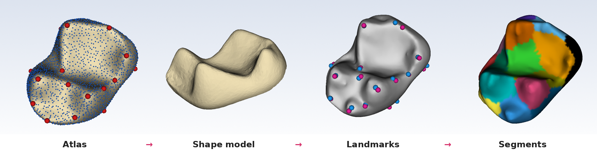
</p>

In this tutorial you'll use **MorphoWeave** in 3D Slicer to:

1. **Build an atlas** (an average molar plus point-to-point correspondences) from 110 landmarked molars.
2. **Turn it into a statistical shape model** and watch how molar shape varies.
3. **Transfer landmarks automatically** to 5 molars the model has never seen, then check them against the manual landmarks.
4. **Segment every molar** into matching surface regions.

| | |
|---|---|
| **Time** | About 30 minutes. Compute time is under 5 minutes in total. |
| **You need** | a recent [3D Slicer](https://download.slicer.org/) release (screenshots use 5.13), ~300 MB free disk space, and an internet connection the first time you run Landmark Transfer. |
| **Data** | 115 molar crown surfaces with 16 manual landmarks each, included in this repository (30 MB). The data accompanies the [MorphoWeave preprint](https://doi.org/10.64898/2026.09.28.755222). |
| **No coding** | Everything is done with buttons. One optional copy-and-paste snippet scores your predictions. |

**Contents:** [0. Setup](#0-setup) · [Key ideas](#key-ideas-in-60-seconds) · [1. Atlas Builder](#1-build-an-atlas-atlas-builder) · [2. Model Library](#2-build-and-explore-a-shape-model-model-library) · [3. Single transfer](#3-transfer-landmarks-to-one-molar-landmark-transfer--single-run) · [4. Check](#4-check-the-prediction) · [5. Batch](#5-landmark-many-molars-at-once-landmark-transfer--batch) · [6. Segmentation](#6-segment-every-molar-into-matching-regions-surface-segmentation) · [Going further](#going-further) · [Troubleshooting](#troubleshooting)

---

## 0. Setup

### 0.1 Install MorphoWeave

1. Open 3D Slicer and go to **View → Extension Manager**.
2. Search for **MorphoWeave**, click **Install**, and restart Slicer when prompted.
3. Check that the **Modules** menu now has a **MorphoWeave** category with four modules: **Atlas Builder**, **Model Library**, **Landmark Transfer**, and **Surface Segmentation**.

> [!NOTE]
> If MorphoWeave isn't in the Extension Manager yet, clone the [repository](https://github.com/agporto/SlicerMorphoWeave), then in Slicer open **Developer Tools → Extension Wizard → Select Extension** and choose the cloned folder. See [developer installation](https://github.com/agporto/SlicerMorphoWeave#developer-installation).

### 0.2 Get the workshop files (data included)

The molar data is already in this repository, split into training and test sets, along with empty folders for every result you'll create. There's nothing to set up.

- **Without git:** click the green **Code** button at the top of this page → **Download ZIP**, then extract it (about 30 MB).
- **With git:**
  ```bash
  git clone https://github.com/agporto/Workshop-MorphoWeave.git
  ```

Everything you need is in the `molar_tutorial/` folder:

```text
molar_tutorial/
├── train/
│   ├── models/          110 molar surfaces (.ply)
│   └── landmarks/       their 110 manual landmark files (.mrk.json), 16 points each
├── test/
│   ├── models/          5 held-out molars: a10, h08, k01, q02, x02
│   ├── landmarks/       their manual landmarks, used only to check your predictions
│   └── predicted/       empty: batch predictions go here (step 5)
├── output/              empty: Atlas Builder results go here (step 1)
├── MorphoWeaveModels/   empty: your saved shape model goes here (step 2)
└── segmentation/        empty: segmented regions go here (step 6)
```

Throughout the tutorial, `molar_tutorial/…` means this folder, wherever you extracted or cloned it. For example, on Windows it might be `C:\Users\you\Downloads\Workshop-MorphoWeave-main\molar_tutorial`.

**Why 5 held-out molars?** A fair test of automatic landmarking uses specimens the model has never seen. The atlas and shape model are built from `train/` only. You'll then predict landmarks on the 5 molars in `test/` and compare them against their manual landmarks.

> [!NOTE]
> The meshes were aligned in an earlier MorphoWeave run, which is why their names end in `_sas_align`. That doesn't matter here: Atlas Builder aligns its inputs again anyway.

---

## Key ideas in 60 seconds

| Term | What it means here |
|---|---|
| **Sparse landmarks** | The 16 manually placed points on each molar. These are what you want to predict on new specimens. |
| **Atlas** | An average molar surface, built from the 110 training molars after aligning them. |
| **Dense correspondences** | ~2,000 points placed on the atlas and mapped onto every specimen, so that point #500 sits on the same anatomical spot on every molar. |
| **Statistical shape model (SSM)** | A summary of how those dense points vary across specimens, as principal components (PCs). PC1 is the strongest pattern of variation. |
| **Template → target** | Landmark Transfer warps the *template* (the atlas, with its landmarks) onto a *target* (a new molar). The SSM keeps the warp biologically plausible. |

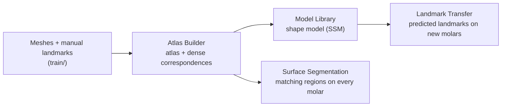

---

## 1. Build an atlas (Atlas Builder)

Go to **Modules → MorphoWeave → Atlas Builder**.

<p align="center">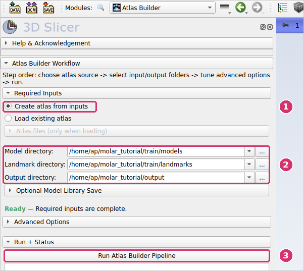</p>

1. Keep **Create atlas from inputs** selected.
2. Set the three folders. Click each **…** button to browse:

   | Field | Folder |
   |---|---|
   | **Model directory** | `molar_tutorial/train/models` |
   | **Landmark directory** | `molar_tutorial/train/landmarks` |
   | **Output directory** | `molar_tutorial/output` |

   The status line turns green: **Ready — Required inputs are complete.**
3. Click **Run Atlas Builder Pipeline**.

<details>
<summary>What's in <b>Advanced Options</b>? (the defaults are fine for this tutorial)</summary>

<p align="center">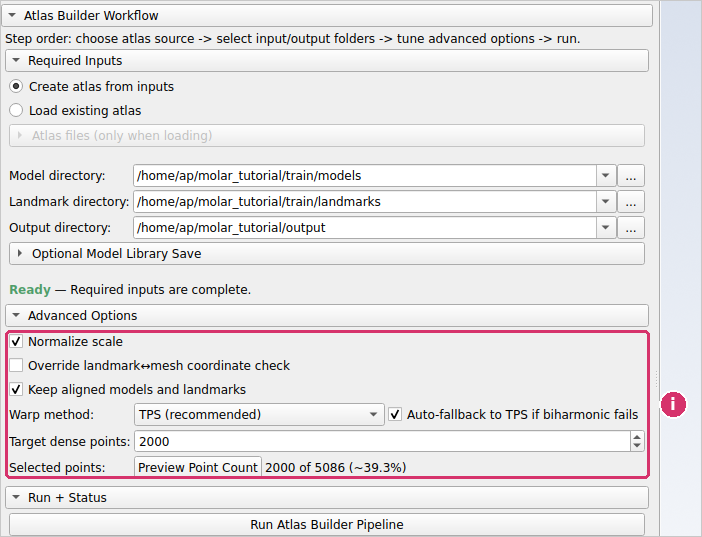</p>

- **Normalize scale** (on): removes size differences, so the atlas captures shape only.
- **Override landmark↔mesh coordinate check** (off): leave this off. The check catches landmarks saved in a different coordinate system from their meshes.
- **Keep aligned models and landmarks** (on): saves the aligned copies. Surface Segmentation uses them in step 6, so keep this on.
- **Warp method**: TPS (thin-plate spline) is the recommended default.
- **Target dense points** (2,000): the number of dense correspondence points. Click **Preview Point Count** to see how many atlas vertices that is (here, *2000 of 5086*).

</details>

The run takes about 30 seconds. The log narrates each stage: picking the specimen closest to the mean shape (`w18_sas_align`), pre-aligning, averaging, re-aligning everything to the atlas, and exporting dense points for each specimen.

<p align="center">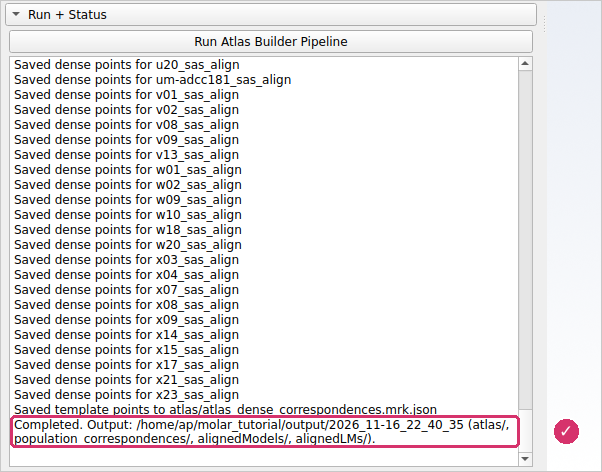</p>

**✅ Checkpoint:** The log ends with **Completed. Output: …/output/&lt;timestamp&gt;**. That timestamped folder now contains:

```text
output/2026_11-16_22_40_35/          ← your timestamp will differ
├── atlas/
│   ├── atlas_model.ply                     the average molar
│   ├── atlas_sparse_landmarks.mrk.json     its 16 landmarks
│   └── atlas_dense_correspondences.mrk.json  its ~2,000 dense points
├── population_correspondences/       the same ~2,000 points on each of the 110 molars
├── alignedModels/                    the 110 molars, aligned to the atlas
└── alignedLMs/                       their landmarks, aligned
```

<details>
<summary>Optional: look at the atlas</summary>

The atlas isn't left in the scene after the run. To see it, drag `atlas_model.ply`, `atlas_sparse_landmarks.mrk.json`, and `atlas_dense_correspondences.mrk.json` from the `atlas/` folder into the Slicer window and click **OK**.

<p align="center">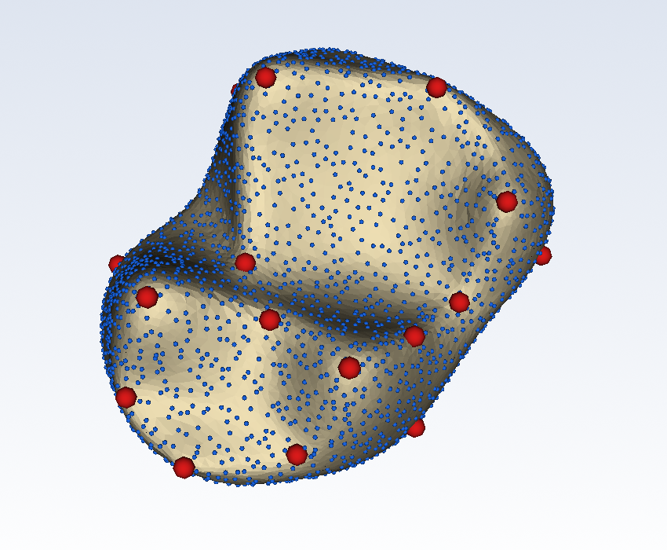</p>

*Red: the 16 sparse landmarks. Blue: the 2,000 dense correspondences. Colors were adjusted for this figure.*

Clear the scene with **File → Close Scene** before you continue.
</details>

---

## 2. Build and explore a shape model (Model Library)

Go to **MorphoWeave → Model Library**.

<p align="center">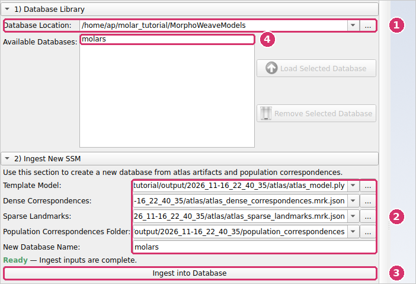</p>

1. **Database Location** is where shape models are stored permanently. The default (`Documents/MorphoWeaveModels`) is fine. This tutorial uses `molar_tutorial/MorphoWeaveModels` to keep everything in one place.
2. Expand **2) Ingest New SSM** and fill in the fields from your timestamped output folder:

   | Field | File or folder |
   |---|---|
   | **Template Model** | `atlas/atlas_model.ply` |
   | **Dense Correspondences** | `atlas/atlas_dense_correspondences.mrk.json` |
   | **Sparse Landmarks** | `atlas/atlas_sparse_landmarks.mrk.json` |
   | **Population Correspondences Folder** | `population_correspondences/` |
   | **New Database Name** | `molars` |

3. Click **Ingest into Database**. This takes about 2 seconds, and the status bar shows *Success: Database 'molars' saved.*
4. **molars** appears under **Available Databases**.

> [!TIP]
> Next time you can skip this step. Expand **Optional Model Library Save** in Atlas Builder, tick **Save SSM to Model Library**, and enter a name. The shape model is then saved automatically when the atlas finishes.

### Load the model and explore shape variation

<p align="center">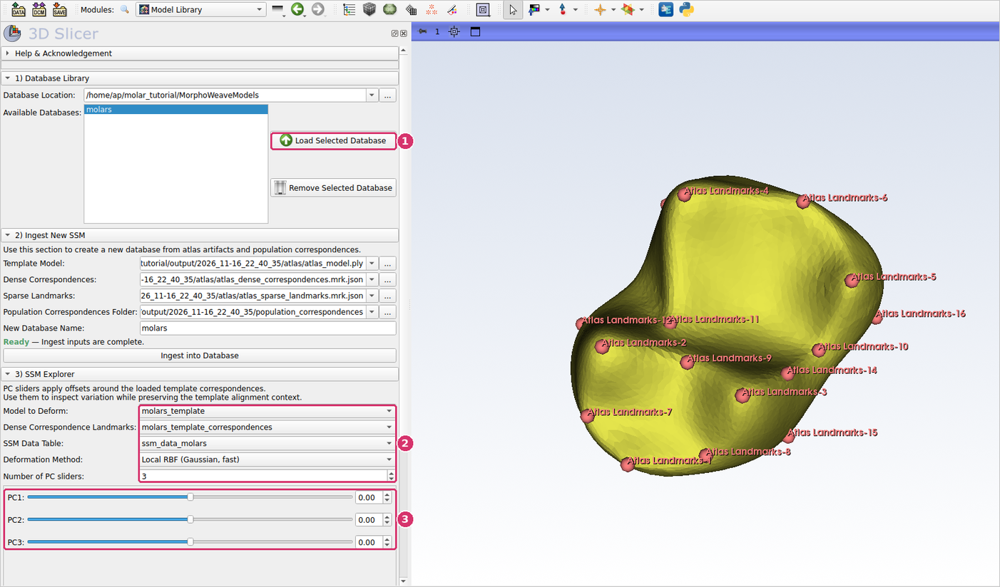</p>

1. Click **molars** in the list, then **Load Selected Database**.
2. **SSM Explorer** fills itself in: **Model to Deform** = `molars_template`, **Dense Correspondence Landmarks** = `molars_template_correspondences`, **SSM Data Table** = `ssm_data_molars`. The template molar appears in 3D.
3. Drag the **PC1** slider to about **−2** and then **+2** (units are standard deviations). Then try **PC2**. Click **Reset Explorer PCs** when you're done.

<p align="center">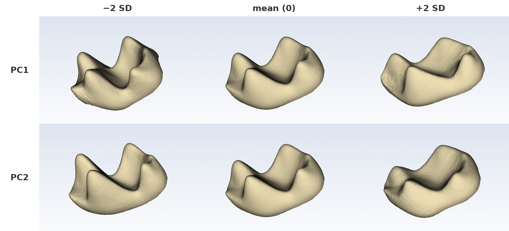</p>

*Side view of the template at −2 SD, the mean, and +2 SD along PC1 and PC2 (landmarks hidden for clarity). Moving along a PC changes cusp height, crown length, and how deep the basins are, all together. Those are the correlated patterns of variation in the 110 training molars.*

> [!NOTE]
> The sliders deform the surface and its dense points. The 16 labeled sparse landmarks stay where they are, so at extreme slider values they can look like they're floating off the surface. That's expected.

**✅ Checkpoint:** The scene contains four nodes named `molars_template`, `molars_template_correspondences`, `molars_template_sparse_landmarks`, and `ssm_data_molars`. Landmark Transfer uses all four.

---

## 3. Transfer landmarks to one molar (Landmark Transfer → Single Run)

Start with one held-out molar so you can watch each step.

1. Load the target. Click **Add Data** (top-left toolbar), choose `molar_tutorial/test/models/a10_sas_align.ply`, and click **OK**. Don't load its manual landmarks yet.
2. Go to **MorphoWeave → Landmark Transfer** and open the **Single Run** tab. The numbers in the screenshot match steps 3–5 below.

<p align="center">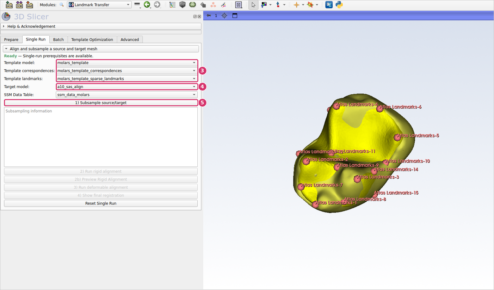</p>

3. The three template selectors and **SSM Data Table** are already filled with the `molars_…` nodes you just loaded. If any are empty, pick the matching `molars_…` node.
4. Set **Target model** to `a10_sas_align`.
5. Click the four buttons in order, starting with **1) Subsample source/target**. Each one enables the next:

| Button | What it does | Time |
|---|---|---|
| **1) Subsample source/target** | Turns both surfaces into ~2,000-point clouds. The box reports, for example, *source pointcloud has 1941 points, target pointcloud has 2030 points*. | < 1 s |
| **2) Run rigid alignment** | Finds the best rotation, translation, and scale using surface features (FPFH + RANSAC), then refines it (ICP). | < 1 s |
| **2b) Preview Rigid Alignment** | Shows the template (red) over the target (blue). | instant |
| **3) Run deformable alignment** | Warps the template onto the target. The shape model constrains the warp first, then a free-form step adds local detail. The landmarks are carried along. | ~3 s |
| **4) Show final registration** | Shows the warped template (green) on the target (blue) with the predicted landmarks. | instant |

> [!IMPORTANT]
> **First run only:** Landmark Transfer needs two Python packages, `tiny3d-rs` and `rustcpd`. Slicer asks before installing them. Accept the install, wait for the install to finish, and restart Slicer if it asks you to. Then reload the database (step 2) and the target, and continue.

<p align="center">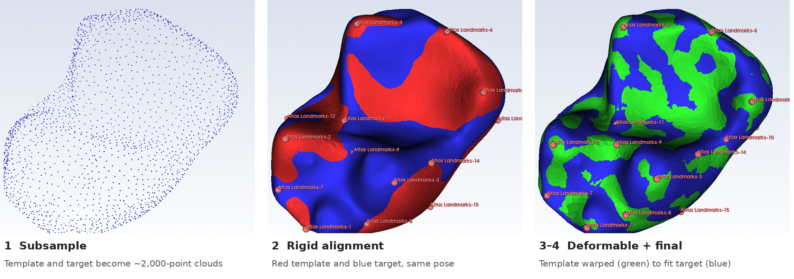</p>

**What to look for:**

- **After 2b:** the red and blue surfaces should face the same way and roughly overlap, with cusps over cusps. If they point in different directions, stop and check that the right target is selected.
- **After 4:** green and blue should be interleaved everywhere, like a fine camouflage pattern. Large solid patches of one color mean the fit is poor there.

**✅ Checkpoint:** A new folder appears in the **Data** module under **MorphoWeave Landmark Transfer runs → Run &lt;date-time&gt; – molars_template→a10_sas_align**. It contains a node called **Predicted Landmarks (no projection)**. Those are your 16 predicted landmarks.

> [!NOTE]
> "No projection" is expected, because **Advanced → Skip projection** is on by default. If you turn it off, an extra step snaps each landmark onto the target surface, and the output node is named **Refined Predicted Landmarks** instead.

---

## 4. Check the prediction

Because `a10` was held out, you have its manual landmarks to compare against.

1. Click **Add Data** and load `molar_tutorial/test/landmarks/a10_sas_align.mrk.json`. It appears as **a10_sas_align_1**. Slicer adds `_1` because the mesh already uses that name.
2. Open the **Data** module. Hide **Warped Source** with its eye icon. Show **a10_sas_align_1**, then double-click its color swatch and choose blue so it stands out from the pink predictions.

<p align="center">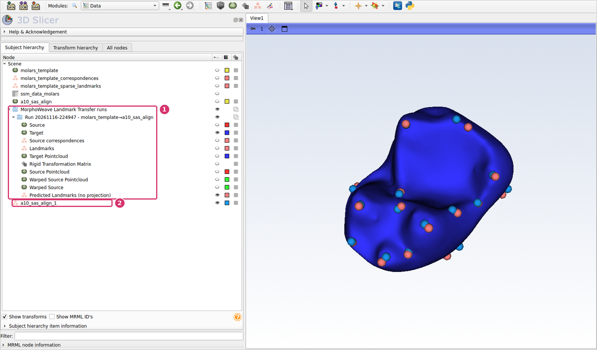</p>

3. Rotate the molar. Each pink prediction should sit next to its blue manual partner.

<p align="center">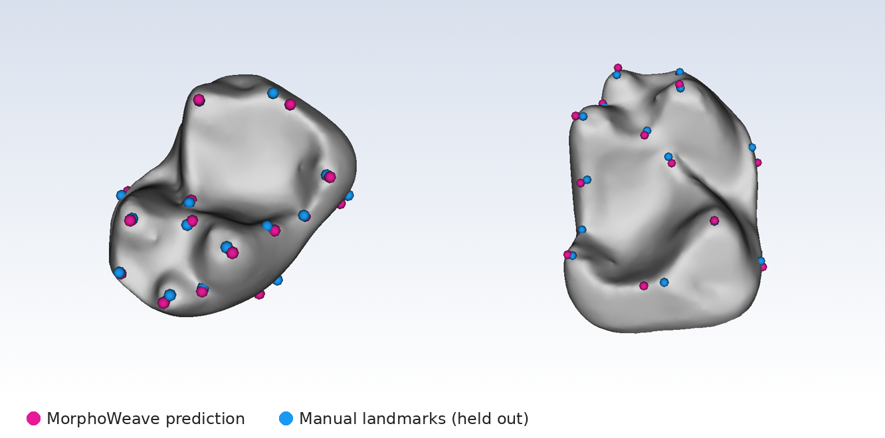</p>

*Oblique and occlusal views of `a10`, with labels hidden and the surface recolored grey. Most pairs nearly touch. The largest gaps are on the crown margin, where the landmark position is harder to define even by hand.*

On this specimen the mean distance between predicted and manual landmarks is **2.4% of the tooth's size** (bounding-box diagonal). The worst single point is 6.3%.

**Save the prediction:** click **Save** (top-left toolbar), keep only **Predicted Landmarks (no projection)** ticked, choose a folder, and click **Save**. Markups save as `.mrk.json`.

> [!TIP]
> To judge a point, check whether it's on the right *feature*, such as the tip of the correct cusp. Being on the surface isn't enough. A point can be on the surface and still be on the wrong cusp.

---

## 5. Landmark many molars at once (Landmark Transfer → Batch)

Once a single run looks good, apply the same settings to a whole folder. The numbers in the screenshot match the steps below.

<p align="center">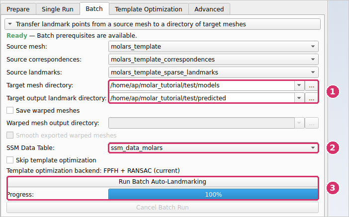</p>

1. Open the **Batch** tab. **Source mesh**, **Source correspondences**, **Source landmarks**, and **SSM Data Table** are pre-filled with the `molars_…` nodes.
2. Set **Target mesh directory** to `molar_tutorial/test/models` and **Target output landmark directory** to `molar_tutorial/test/predicted`.
3. Leave **Skip template optimization** unticked. Before registering each specimen, MorphoWeave then searches the shape model for a starting template that fits that specimen better.
4. Click **Run Batch Auto-Landmarking**. The 5 molars take about 40 seconds.

**✅ Checkpoint:** The progress bar reaches **100%**, and `test/predicted/` contains five `.mrk.json` files, one per molar, with the same names as the meshes.

> [!WARNING]
> Batch output files use the **same filenames** as the input meshes. Always point **Target output landmark directory** at an empty folder, never at a folder that holds your manual landmarks.

<details>
<summary><b>Optional: score all five predictions</b></summary>

Edit the `WORK` line to point at your `molar_tutorial` folder, then paste the block into **View → Python Console**. It's also saved as [`scripts/check_accuracy.py`](scripts/check_accuracy.py).

```python
import glob, json, os
import numpy as np
import vtk

# EDIT THIS: the molar_tutorial folder inside the workshop files (Windows backslashes are fine)
WORK = os.path.expanduser(r"~/Downloads/Workshop-MorphoWeave-main/molar_tutorial")

if not os.path.isdir(os.path.join(WORK, "test", "predicted")):
    raise FileNotFoundError(f"{WORK} doesn't look like the molar_tutorial folder. Check the WORK path above.")

def read_points(path):
    with open(path, encoding="utf-8") as f:
        markup = json.load(f)["markups"][0]
    pts = np.array([p["position"] for p in markup["controlPoints"]])
    return pts * [-1, -1, 1] if markup.get("coordinateSystem", "LPS") == "LPS" else pts

def tooth_size(mesh_path):
    reader = vtk.vtkPLYReader(); reader.SetFileName(mesh_path); reader.Update()
    b = reader.GetOutput().GetBounds()
    return np.linalg.norm([b[1] - b[0], b[3] - b[2], b[5] - b[4]])

print(f"{'specimen':<16}{'mean error':>12}{'worst point':>14}")
for pred_path in sorted(glob.glob(os.path.join(WORK, "test", "predicted", "*.mrk.json"))):
    name = os.path.basename(pred_path).replace(".mrk.json", "")
    manual = read_points(os.path.join(WORK, "test", "landmarks", name + ".mrk.json"))
    errors = np.linalg.norm(read_points(pred_path) - manual, axis=1)
    errors = 100 * errors / tooth_size(os.path.join(WORK, "test", "models", name + ".ply"))
    print(f"{name:<16}{errors.mean():>11.1f}%{errors.max():>13.1f}%  (point {errors.argmax() + 1})")
```

Expected output (your numbers may differ slightly):

```text
specimen          mean error   worst point
a10_sas_align           2.4%          6.3%  (point 15)
h08_sas_align           2.2%          6.9%  (point 12)
k01_sas_align           2.3%          5.0%  (point 1)
q02_sas_align           1.8%          3.6%  (point 13)
x02_sas_align           2.3%          5.8%  (point 15)
```

Five specimens are only a sanity check. To report accuracy in a study, hold out more specimens, or use cross-validation.
</details>

---

## 6. Segment every molar into matching regions (Surface Segmentation)

Because the dense correspondences mark the same spots on every molar, MorphoWeave can split all 110 surfaces into **matching** regions in one run.

Go to **MorphoWeave → Surface Segmentation**.

<p align="center">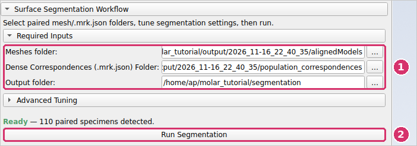</p>

1. Set the folders, using your timestamped Atlas Builder output folder:

   | Field | Folder |
   |---|---|
   | **Meshes folder** | `output/<timestamp>/alignedModels` |
   | **Dense Correspondences (.mrk.json) Folder** | `output/<timestamp>/population_correspondences` |
   | **Output folder** | `molar_tutorial/segmentation` |

   The status reads **Ready — 110 paired specimens detected.** Meshes and correspondence files are paired by filename.
2. Click **Run Segmentation**. With the default 15 segments, this takes about 3 minutes.

**✅ Checkpoint:** The status reads **Complete**. The first three specimens are previewed in the scene as `…_seg_preview` models, overlapping because they're aligned. Toggle them one at a time in the **Data** module.

<p align="center">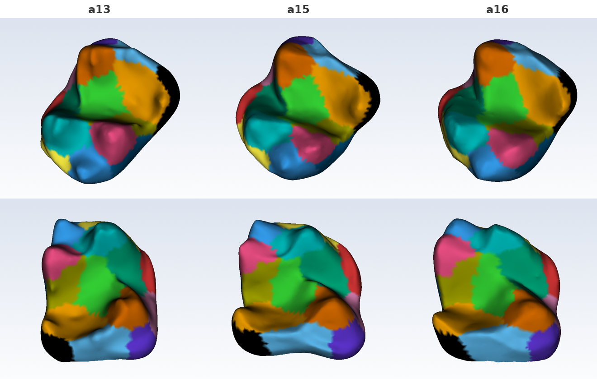</p>

*The same 15 regions, in the same colors, on three different molars. The black region is just how one label is colored in the preview.*

The output folder contains `<specimen>_seg_00.ply` … `_seg_14.ply` (one mesh per region, per molar) and `MorphoWeaveSurfaceSegmentation_locus_labels.txt`, which records the region each dense point belongs to. Under **Advanced Tuning**, you can change **# Segments (k)** or tick **Auto-tune (k, α)** to let MorphoWeave choose the number of segments.

---

## 🎉 You're done

You built an atlas and a shape model from 110 molars, predicted landmarks on 5 unseen molars at about 2% error, and segmented the whole sample into matching regions.

### Your files at a glance

```text
molar_tutorial/
├── output/<timestamp>/      atlas, dense correspondences, aligned meshes (step 1)
├── MorphoWeaveModels/molars/  the saved shape model (step 2)
├── test/predicted/          automatic landmarks for the 5 held-out molars (step 5)
└── segmentation/            per-region meshes for all 110 molars (step 6)
```

---

## Going further

### Template Optimization tab

<p align="center">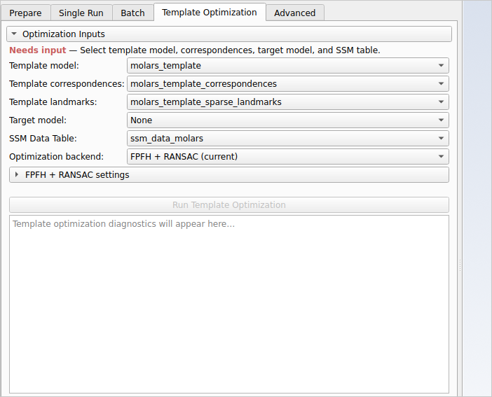</p>

This tab finds the version of the template, within the shape model, that best fits one target. It then saves that template as a new scene node (`GridRANSAC_TemplateModel` or `PoseEM_TemplateModel`), which you can choose as the source in **Single Run** or **Batch**. It's most useful when your targets differ a lot from the average shape. Batch mode already does this for each specimen unless **Skip template optimization** is ticked.

- **FPFH + RANSAC (current)**: the default, feature-based search.
- **Pose-marginalized EM (experimental)**: tests many starting orientations. It's helpful when the target's orientation is unknown or its anatomy is roughly symmetric.

### Advanced tab

<p align="center">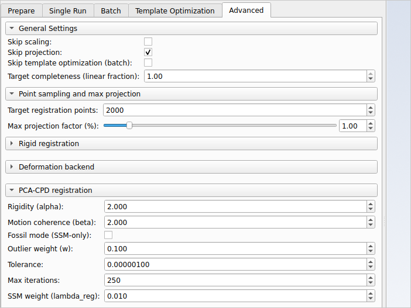</p>

These are the settings to try first if a result looks off:

| Symptom | Setting to try |
|---|---|
| Landmarks float slightly above or below the surface | Untick **Skip projection** |
| Rigid preview points the wrong way | Open **Rigid registration** and increase the FPFH search radius or RANSAC distance threshold |
| Warp is too floppy or produces odd shapes | Increase **SSM weight (lambda_reg)** or **Rigidity (alpha)** |
| Warp is too stiff and misses local detail | Decrease **SSM weight** or **Rigidity** |
| Target is broken or incomplete (e.g. a fossil) | Set **Target completeness** below 1.0, and consider **Fossil mode (SSM-only)** |

### Use your own data

Use the same workflow with your own specimens. The requirements:

- one mesh (`.ply`, `.stl`, `.obj`, `.vtk`, or `.vtp`) and one landmark file (`.mrk.json` or `.fcsv`) per specimen, **with the same base name**;
- the **same number of landmarks, in the same order**, on every specimen;
- meshes and landmarks in the same coordinate system (if you placed the landmarks in Slicer on those meshes, they are).

[SlicerMorph](https://slicermorph.github.io/)'s **Surface Toolbox** helps clean up meshes beforehand (decimation, hole filling, smoothing).

---

## Troubleshooting

| What you see | What to do |
|---|---|
| Atlas Builder stays at **Needs input** | All three folders must exist. The model and landmark folders need matching filenames. |
| *Landmark count mismatch* | One or more landmark files have a different number of points. Fix or remove those specimens. |
| Atlas Builder warns about the landmark↔mesh coordinate check | Load one mesh with its landmarks in Slicer. If the points don't sit on the surface, the files use different coordinate systems (RAS vs LPS). |
| Landmark Transfer selectors are empty | Load the database again in **Model Library**. The template, correspondences, sparse landmarks, and `ssm_data_…` table must all come from the same database. |
| **Target model** is empty | Load a mesh with **Add Data**, then pick it in the selector. |
| Dependency install fails or asks to restart | Restart Slicer, open Landmark Transfer again, and accept the install. An internet connection is required the first time. |
| *Subsampling produces no points* | Increase **Advanced → Target registration points**, or make sure **Skip scaling** is unticked. |
| PCA-CPD stops early or reports a point-count mismatch | The SSM table and template correspondences come from different databases. Reload a single database. |
| Something else | Open **View → Error Log** and include the message when you [open an issue](https://github.com/agporto/SlicerMorphoWeave/issues). |

---

## How to cite

If you use MorphoWeave, please cite the preprint:

```text
Porto, A., Wolcott, K. A., Fenner, K. L., Gordon, C., Shi, B., & Stanley, E. L. (2026).
Biology-guided machine learning for robust anatomical correspondence across biodiversity datasets.
bioRxiv. https://doi.org/10.64898/2026.09.28.755222
```

<details>
<summary>BibTeX</summary>

```bibtex
@article{porto2026morphoweave,
  title   = {Biology-guided machine learning for robust anatomical correspondence across biodiversity datasets},
  author  = {Porto, Arthur and Wolcott, Katherine A. and Fenner, Kelsey L. and Gordon, Caleb and Shi, Breanna and Stanley, Edward L.},
  journal = {bioRxiv},
  year    = {2026},
  doi     = {10.64898/2026.09.28.755222},
  url     = {https://www.biorxiv.org/content/10.64898/2026.09.28.755222v1}
}
```

</details>

Please also cite 3D Slicer, and SlicerDenseCorrespondenceAnalysis when you use Atlas Builder. See the main [README](https://github.com/agporto/SlicerMorphoWeave#citation) for details.

---

## License

This tutorial (text, figures, scripts, and the molar data in `molar_tutorial/`) is licensed under [CC BY 4.0](LICENSE). If you reuse the molar data, please cite the preprint above. You're free to reuse and adapt it, including for your own workshops, as long as you give credit. MorphoWeave itself is distributed under the [BSD 2-Clause License](https://github.com/agporto/SlicerMorphoWeave/blob/main/LICENSE).

---

<sub>Screenshots were taken with 3D Slicer 5.13 on Linux, using the molar data and folder layout above. Run times were measured on a multi-core workstation, so expect yours to differ. Panel layouts may vary slightly between Slicer versions and platforms.</sub>
